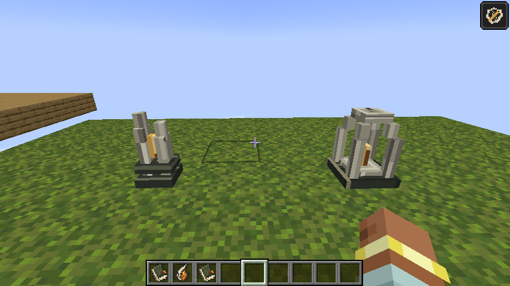

# Charter route instruments — alpha.19

Historical instrument study. Alpha.20 replaces these manufactured silhouettes
with [rooted witness stumps and a hollow tree](stillwood-hollow.md).

The route is made legible by instruments from the same workshop as the terminal
and compass. They use pale longitudinal grain, dark bindings and restrained amber.
Neither object is a piece of the living Bloom; the Charter contains a small seam
of the same material to establish its bearings. The journal describes what can be
observed without explaining the origin of that response.

**Witness Mark** is the checkpoint's display name. Two uneven split staves hold
an amber seam above a bound foot. A taller fork makes the silhouette readable
against terrain. Touching the mark settles the route reading, banks the existing
checkpoint reward and can attract the existing challenge. Its answer is a low
wooden knock, a soft chime and a short amber dust pulse.

**Recall Anchor** is the exit's display name. Four inward-stepped ribs surround a
small amber splinter and rise into a hollow crown. Its aperture echoes the terminal
portal. Using the anchor still requires the full route, required objectives, cargo
and any bound guardian proof. A low resonant chime replaces the achievement fanfare
on successful extraction.

Both remain inside their original one-block placement cells, with the same ids
and no new block-state properties or saved data. Selection and collision come
from their actual model elements through `FieldMachineShapes`. Their clefts and
apertures do not select invisible cube faces, and the instruments are not sturdy
floors. They remain indestructible route markers with the existing cleanup and
recovery rules. No global settled/unsettled state is attached to a shared marker:
two parties can have different progress at the same address.

`tools/route_marker_art.py` owns the native 16px textures and models, called by
the existing checkpoint/exit generators in `tools/heartwood_art.py`. The ordinary
`tools/gen_textures.py` command regenerates them. The field guide and messages
connect the new names to familiar checkpoint/extraction instructions.

The shape GameTest verifies selectable staves, the witness cleft, both recall
apertures and the absence of full-cube collision/support. The asynchronous siege
fixture has separate authored columns: its running markers must not serve as
accidental floors for other tests in the same batch.

Build/alphaBundle, 176 unit tests and all 161 core GameTests pass (164 reported
including three optional installed-biome probes). Native item-model validation
and generated guide-page checks pass as well.

The live proof uses a moss platform in the disposable MCP debug world. Left:
Witness Mark. Right: Recall Anchor. The client was restarted with alpha.19;
the screenshot shows the native block models rather than an illustration.
