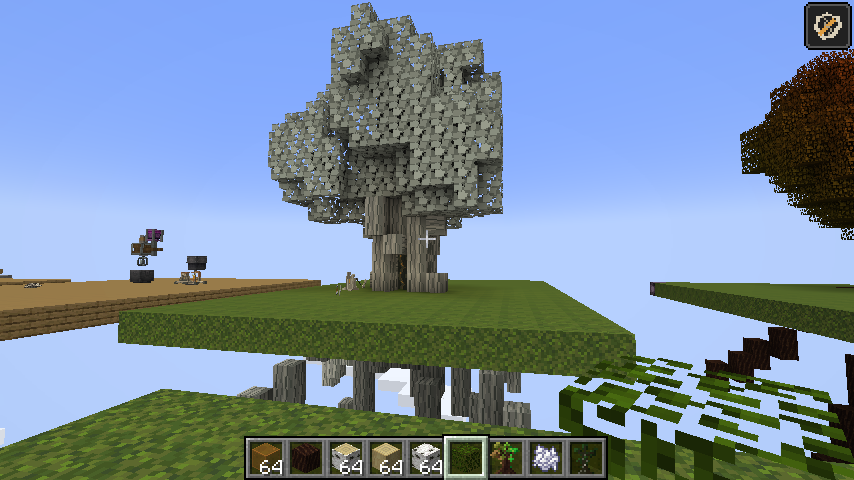

# Player-authored Stillwood Hollow — alpha.22

The player built the tree in Minecraft and chose the pale bark/amber palette.
The complete native source is [preserved here](art-direction/player-tree/README.md).
It contains 930 non-air blocks, including log axes, leaf states, a hanging detail,
two portal markers and roots reaching sixteen blocks below the entrance. The
17 × 31 × 17 source box contains the full build. The original remains untouched.

`tools/recall_tree_layout.py` derives the layout from that native NBT. It no longer
invents the tree. Geometry is preserved voxel for voxel; Twilight Forest source
materials map to the mod's own palette. Runtime requires no Twilight Forest.
The shipped native protected template is `data/expeditions/structure/stillwood_hollow.nbt`.

Placement yields to existing terrain. Only air can become tree pieces: terrain,
plants, fluids, other markers and existing builds are never removed to make room.
Obstructed or out-of-bounds tree pieces are omitted without drops. The doorway,
two portal cells and safe floor remain mandatory, so unsafe entries still refuse
or use the existing bounded route retries. Planned checkpoint/portal overlaps
are tested only against this necessary entrance space; optional wood can clip.

The deployed structure is unbreakable in Survival and has no block loot. Using
the trunk or crossing the portal still delegates to authoritative completion:
all checkpoints, required objectives, cargo and exact guardian proof must hold.
Timed requirements are evaluated at extraction. Unfinished walk-through attempts
stay quiet; deliberate wood use explains the refusal. Rewards remain exactly once.

A per-root placed-piece manifest lives with runs, balances and live markers in
`ExpeditionSavedData`, never in a second file. Only pieces actually placed enter
that record. Recovery validates those exact indices and both portal cells;
intentional clipping stays valid, but missing placed pieces, missing manifests
and malformed records fail safely. The full structure despawns at run end through
per-position ownership checks. Native obstructions remain and no block items drop.
Orphan pruning covers both markers and manifests.

Root `tree_layout=1` identifies the authored layout. Existing compact exits,
alpha.20 eight-part arches and alpha.21 procedural trees keep their prior flags
and part indices. Their layouts are retained for recovery/cleanup. New pieces
append after index 120, rather than reassigning persisted ids. The displayed item
shows only the above-ground silhouette; the complete roots remain in the source
and placement template.

Verified: build/alphaBundle, 176 unit tests and 169 core GameTests (172 reported
including the three optional biome probes). Native NBT loading, exact-source
geometry, mod-independent palette, clipping without drops, persisted/malformed
manifests, recovery cleanup, Survival protection, actual block interaction and
portal callbacks all have checks. Live preview uses a separate development fixture.

