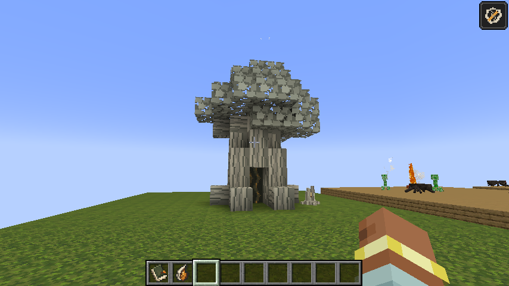
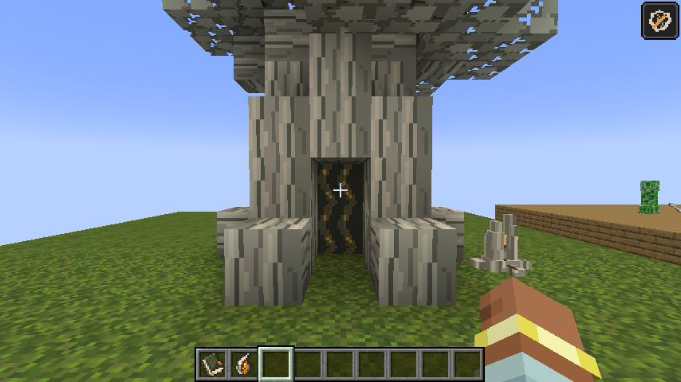

# Stillwood route landmarks — alpha.21

The expedition's bearings gather around pale wood related to the Stillness and
the Bloom. The field guide records what the player can observe: a persistent cut,
an amber seam, and an opening where solid wood should be. It leaves the origin
of those similarities unanswered. These landmarks grant neither infection immunity
nor workshop power.

**Witness Stump** is the checkpoint. A broken, rooted sapling encloses an amber
seam in its split. It replaces the manufactured stake and dark plinth. Use it
in compass order to bank the existing checkpoint reward. The same challenges
still answer activation, with a low wooden knock and a restrained amber pulse.

**Stillwood Hollow** is extraction. An eight-block-tall tree has a three-by-three trunk,
a recessed chamber and a seven-block-wide, irregular canopy. Its roots, logs,
branches and leaves are ordinary full block cubes with native bark and leaf
textures. The doorway opens into the trunk; the animated dark amber portal sits
a full block farther inside. Each animation
frame is a native 16px tile. The carried item shows a miniature of the whole tree.

Walk into the hollow after meeting the route's requirements, or use any piece of
its wood. The logical server still requires every checkpoint, required objective,
physical cargo and bound guardian proof. Walking past an unfinished hollow stays
quiet. Interacting with it provides the normal refusal explanation. Another exit
address cannot settle the player's charter. Successful recall returns the party
to its terminal and keeps the existing exactly-once reward settlement.

The structure is 114 actual block cells: the stable `expedition_exit` root and
113 `recall_tree_part` segments. The canonical template is
`assets/expeditions/route/recall_tree.json`, generated by `tools/recall_tree_layout.py`.
Its occupied cells, doorway clearance, supporting floor cells, build limits and
world border are checked
before any route block is written or entry cost charged. It never cuts terrain or
builds around an obstruction. Generated routes reuse the bounded adapter jitter
and fresh-route retries; authored routes refuse when the hollow cannot fit.

Every segment is tracked in the existing SavedData marker set. Startup pruning,
per-position active-run references and run-end cleanup cover the whole tree.
Recovery validates every segment and its expected index; a missing segment fails
the expedition safely and removes the survivors. Unrelated world blocks are
preserved. The root's `grown=false` default preserves compact exits from existing
saves. The first eight part indices and `full_tree=false` preserve alpha.20
hollows; new deployments set both `grown=true` and `full_tree=true`. No domain ledger migration or extra
storage file is introduced.

`RecallTrees` owns the bounded placement layout. `RecallTreePartBlock` resolves
trunk interactions and upper-aperture crossings back to that root. Legacy selection comes from `FieldMachineShapes`. New wood and leaves have
full-cube selection/collision; the entrance and recessed portal have empty collision.
`tools/stillwood_tree_art.py` generates native cube models, textures, blockstates
and a whole-tree miniature, called by `tools/route_marker_art.py` through the normal
`tools/gen_textures.py` command. No additional runtime dependency is required.

The hollow GameTests exercise occupied-footprint refusal without charge/partial
placement, persisted part tracking and damaged recovery cleanup, actual aperture
entity callbacks with checkpoint gating and duplicate-reward protection, and
real trunk use plus legacy compact validation. Existing destination checks now
recognise only the exact intact, non-colliding upper aperture as valid post-placement
headroom. Both synthetic End probes supply terrain beneath the full tree and its roots.

A regression explicitly checks that all new wood/leaves are full cubes, that the
canopy reaches eight blocks and that the walkable portal is recessed.

Build/alphaBundle, 176 unit tests and all 166 core GameTests pass (169 reported
including three optional installed-biome probes). Item-model and guide-page checks
also pass. Alpha.19's earlier instrument study remains recorded in its commit;
this iteration supersedes its manufactured silhouette.

Live debug-world verification also walked the player through the actual opening
on foot without jumping or flying. The automatic-recall test includes a required
timed objective that must be evaluated by `completeRun`; the crossing must not
reject that objective merely because it has not yet been evaluated. Unfinished
walk-through attempts suppress refusal chat, while deliberate wood interactions
still explain the unmet requirements.
